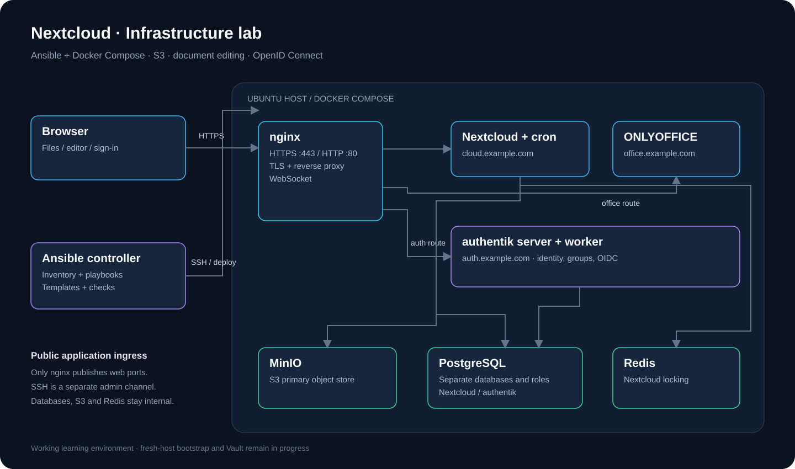
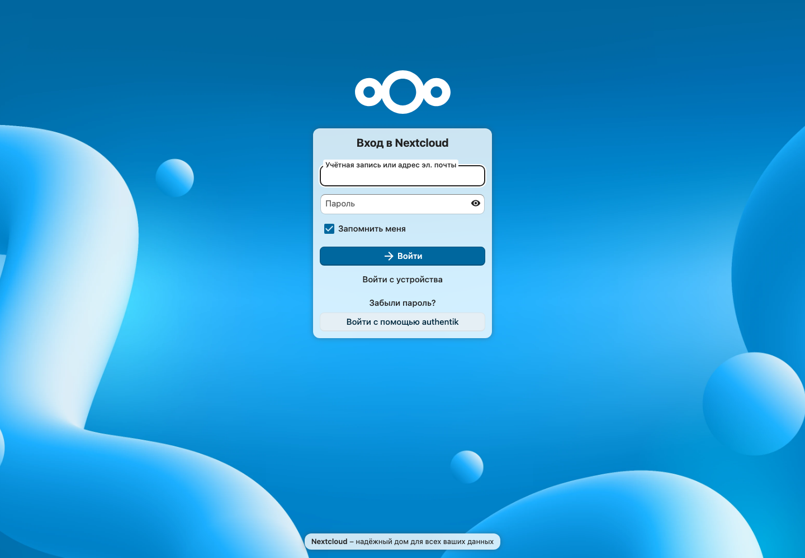
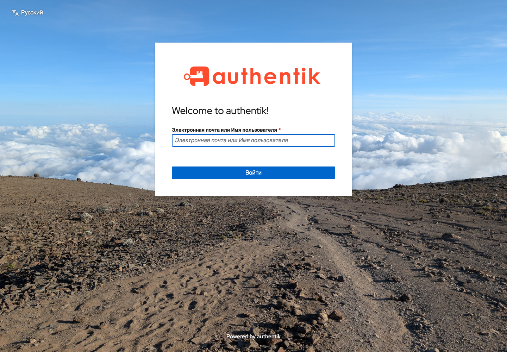

# Nextcloud · Ansible + Docker Compose

Учебный проект файлового хранилища с браузерным редактированием документов,
S3-хранилищем и единым входом. Конфигурацию доставляет Ansible, сервисы запускает
Docker Compose, внешние HTTP-запросы проходят через nginx.

**Статус:** рабочий учебный стенд. Общий запуск на настроенном сервере проверен
с `changed=0`. Полностью автоматический первый запуск на пустом сервере ещё не
реализован и не проверен. Репозиторий не заявляется готовым решением для PROD.



## Что работает

| Компонент | Реализация |
|---|---|
| Nextcloud | Файлы, общий доступ, PostgreSQL, Redis и отдельный cron |
| S3 | MinIO как основное объектное хранилище с первой установки Nextcloud |
| ONLYOFFICE | Отдельный Document Server, JWT, открытие и сохранение документов |
| authentik | OIDC-вход через `user_oidc`, группа доступа и выбранные группы в Nextcloud |
| nginx / TLS | Разделение по доменам, WebSocket, HTTP → HTTPS |
| Сертификаты | Certbot / Let’s Encrypt, systemd-таймер продления и reload nginx |
| Отзыв доступа | Отдельный плейбук: блокировка в authentik и отзыв токенов Nextcloud |
| Повторяемость | Существующие секреты сохраняются; выполнен общий повторный запуск без изменений |

Проверены разрешённые и запрещённые S3-операции, сохранность объектов при
пересоздании MinIO, редактирование документа, доступ к папке через группу,
запрет нового входа, отзыв токенов и back-channel logout.

**Границы:** блокировка пользователя в UI authentik сама по себе не равна отзыву
всех сессий Nextcloud. Для проверенной процедуры используется `disable-user.yml`.
Создание обычных пользователей и назначение их в группы остаются действиями
администратора в authentik; демонстрационные пользователи в deploy не создаются.

## Скриншоты

Реальные страницы входа учебного стенда, снятые в отдельной сессии браузера без
авторизации. Данные пользователей и пароли в снимки не включены.

### Nextcloud



### authentik



## Архитектура и порты

- `cloud.example.com` → nginx → Nextcloud.
- `office.example.com` → nginx → ONLYOFFICE.
- `auth.example.com` → nginx → authentik server.
- Nextcloud использует MinIO, PostgreSQL и Redis по Docker-сетям.
- authentik server/worker используют отдельную базу и роль в том же PostgreSQL.
- Из сервисов приложения опубликованы только порты nginx. SSH — отдельный
  административный доступ; его ограничение ещё не автоматизировано.
- Сертификаты завершаются на nginx. Межсервисный HTTP внутри хоста не шифруется.
- Отдельные базы и роли не являются доказательством полной изоляции PostgreSQL:
  проверка межбазовых прав входит в оставшуюся работу.

## Структура проекта

```text
.
├── README.md
├── requirements-controller.txt       # версия Ansible на управляющем компьютере
├── collections/requirements.yml      # community.docker
├── inventory/
│   ├── example.yml                  # HTTP-стенд
│   └── server.example.yml           # пример полного HTTPS-окружения
├── playbooks/
│   ├── deploy.yml                   # общий порядок развёртывания
│   ├── 01–03                        # учебные проверки SSH, прав и каталогов
│   ├── 04-nginx.yml                 # доставка Compose/nginx, применение и healthz
│   ├── 05–10                        # MinIO, клиент, bucket, policy и пользователь
│   ├── 11–12, 26                    # PostgreSQL и роли приложений
│   ├── 13–15, 24                    # Nextcloud, cron и публичный адрес
│   ├── 16–18, 21                    # подготовка TLS, выпуск и продление
│   ├── 19–20, 22–23                 # ONLYOFFICE и коннектор
│   ├── 25, 27–29                    # authentik, администратор и base URL
│   ├── 30–36                        # OIDC, приложение, доступ и группы
│   ├── verify-storage.yml           # положительные и отрицательные S3-проверки
│   ├── verify-onlyoffice.yml        # проверка из Nextcloud
│   └── disable-user.yml             # отдельная операция отключения пользователя
├── templates/
│   ├── compose.yml.j2
│   ├── nginx-https.conf.j2
│   ├── tls-bootstrap.compose.yml.j2
│   └── renew-certificates.sh.j2
├── files/
│   ├── minio/Dockerfile
│   ├── s3-client/                   # boto3, mc, настройка и проверки S3
│   ├── postgres/                    # SQL-подготовка баз и ролей
│   ├── onlyoffice/start.sh          # чтение JWT из файла перед запуском
│   ├── authentik/                   # повторяемая настройка приложения OIDC
│   └── nginx/                       # HTTP-конфигурации
└── docs/
    ├── OPERATIONS.md                # запуск, проверки и отключение пользователя
    ├── ROADMAP.md                   # ограничения и дальнейшая работа
    └── images/                      # схема и реальные скриншоты
```

Номера плейбуков — этапы обучения, а не порядок выполнения. Порядок задаёт
`playbooks/deploy.yml`. Личные `inventory/local.yml` и `inventory/server.yml`
исключены из Git; на сервере секреты находятся в `{{ project_dir }}/secrets`.

## Требования и установка управляющего окружения

Проверено на Ubuntu 24.04 x86_64 с управлением с Mac, Python 3.13,
Ansible Core 2.21.5 и community.docker 5.4.0. Текущие собственные S3-образы
ориентированы на amd64. Для полного стенда с редактором и authentik использовался
учебный сервер 2 vCPU / 4 ГБ RAM; это факт запуска, не рекомендация для нагрузки.

```bash
python3 -m venv .venv
source .venv/bin/activate
python -m pip install -r requirements-controller.txt
ansible-galaxy collection install -r collections/requirements.yml
cp inventory/server.example.yml inventory/server.yml
```

Заполните адрес, существующего SSH-пользователя с sudo, путь к ключу и домены.
Проверьте SSH host key до запуска Ansible. Для парольного sudo добавьте
`--ask-become-pass` к соответствующим командам.

```bash
ansible-inventory -i inventory/server.yml --graph
ansible nextcloud_servers -i inventory/server.yml -m ansible.builtin.ping
ansible-playbook -i inventory/server.yml playbooks/deploy.yml --syntax-check
```

## Общий запуск на подготовленном сервере

```bash
ansible-playbook -i inventory/server.yml playbooks/deploy.yml
```

**Предусловия:** установлен и запущен Docker с Compose; собственные образы
`nextcloud-lab/minio:2025-10-15` и `nextcloud-lab/s3-client:2` уже загружены;
публичные образы доступны; DNS настроен; каталоги Certbot и сертификаты для всех
включённых HTTPS-доменов уже подготовлены. На новом сервере простой запуск этой
команды пока не заменяет подготовку этих зависимостей.

Для HTTP-стенда можно скопировать `inventory/example.yml` в `inventory/local.yml`.
При `build_storage_images: true` образам MinIO и S3-клиента потребуется Buildx
для сборки на целевом сервере. Режим без сборки для чистого сервера ещё в работе.

Выпуск первоначальных сертификатов выполняется отдельно. `16-tls-bootstrap.yml`
занимает порт 80 и не должен запускаться одновременно с основным nginx.
`21-domain-certificates.yml` сейчас рассчитан на три заданных домена и доступный
HTTP webroot; для первого ACME-аккаунта также требуется регистрация в Certbot.
Не применяйте HTTPS-шаблон до появления сертификатов.

## Проверки

```bash
ansible-playbook -i inventory/server.yml playbooks/verify-storage.yml
ansible-playbook -i inventory/server.yml playbooks/verify-onlyoffice.yml
ansible-playbook -i inventory/server.yml playbooks/deploy.yml
```

Повторный deploy на проверенном стенде завершён с `changed=0`, `failed=0`.
Это не доказательство установки на любом чистом сервере или проверки восстановления.
S3-проверка создаёт временный объект и отдельный тестовый bucket, а затем проверяет
разрешённые и запрещённые операции; её не следует считать полностью read-only.

## Секреты и ограничения

- Пароли генерируются при отсутствии файлов. Смена файла секрета не означает
  автоматической ротации пароля в уже установленном приложении или PostgreSQL.
- Compose secrets в этом проекте — подключённые файлы на сервере, а не Vault.
- Изменённый через UI пароль администратора может отличаться от первоначального
  значения в файле секрета. Не публикуйте эти файлы и содержимое терминала с ними.
- Проверенная сборка ONLYOFFICE — старый сторонний образ 7.2.2.56. Поддержка,
  обновления безопасности, происхождение и условия использования требуют отдельной
  оценки перед эксплуатацией; digest фиксирует содержимое, но не гарантирует его безопасность.
- MinIO и mc собираются из закреплённых исходников; финальный источник поддерживаемых
  образов и доставка из реестра ещё не реализованы. Некоторые другие образы закреплены
  тегами, а не digest.
- Автоматизация authentik использует внутренние модели версии 2026.8.5;
  перед обновлением её необходимо проверять.
- Политики групп применяются при входе. Долговременная синхронизация существующих
  сессий, исключение пользователя из групп и отзыв клиентских доступов требуют
  отдельной проверки; процедура отключения описана в документации.
- Vault и автоматическая защита SSH/firewall ещё не реализованы.

Дальнейшие этапы: [ROADMAP](docs/ROADMAP.md). Операционные команды:
[OPERATIONS](docs/OPERATIONS.md).
